# Réseau d'une PME — Cisco Packet Tracer

Conception et simulation du réseau d'une PME sur **Cisco Packet Tracer** : 7 VLAN, routage inter-VLAN sur un switch multicouche, DHCP centralisé, OSPF, NAT et accès à un « Internet » simulé.

> Projet personnel d'apprentissage des réseaux (mois 5 d'un plan de 12 projets).

## Objectif

Mettre en place un réseau d'entreprise cohérent où chaque service est isolé dans son propre VLAN, avec :

- une communication possible entre les services (routage inter-VLAN) ;
- des adresses distribuées automatiquement (DHCP) ;
- un accès à Internet partagé (NAT) ;
- un routage dynamique entre le cœur de réseau et le routeur (OSPF).

## Résultats obtenus

Le réseau mis en place permet :

- La communication entre les différents VLAN.
- L'attribution automatique des adresses IP par DHCP.
- L'échange dynamique des routes avec OSPF.
- L'accès au réseau Internet simulé grâce au NAT/PAT.
- L'accès aux services DNS et Web du serveur distant.

## Topologie

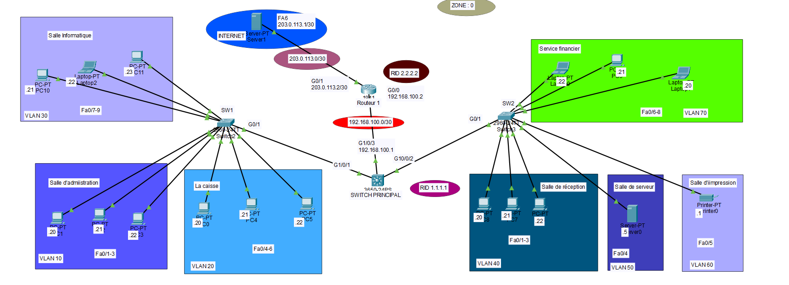

Le réseau est organisé en trois niveaux :

- **Accès** : deux switchs 2960 (SW1 et SW2) auxquels sont branchés les postes de chaque service.
- **Cœur** : un switch multicouche 3650 (SW0) qui fait le routage entre les VLAN.
- **Frontière** : un routeur (Routeur 1) qui relie le réseau interne à « Internet » (un serveur simulé).

Le modèle indiqué ici est le 3650, comme dans le README fourni. À confirmer dans Packet Tracer : la revue précédente mentionnait également un 3560.

## Plan d'adressage

### VLAN

| VLAN | Nom | Réseau | Passerelle | Switch | Ports |
|---|---|---|---|---|---|
| 10 | administration | 192.168.10.0/24 | 192.168.10.1 | SW1 | Fa0/1-3 |
| 20 | caisse | 192.168.20.0/24 | 192.168.20.1 | SW1 | Fa0/4-6 |
| 30 | informatique | 192.168.30.0/24 | 192.168.30.1 | SW1 | Fa0/7-9 |
| 40 | réception | 192.168.40.0/24 | 192.168.40.1 | SW2 | Fa0/1-3 |
| 50 | serveur | 192.168.50.0/24 | 192.168.50.1 | SW2 | Fa0/4 |
| 60 | impression | 192.168.60.0/24 | 192.168.60.1 | SW2 | Fa0/5 |
| 70 | finance | 192.168.70.0/24 | 192.168.70.1 | SW2 | Fa0/6-8 |

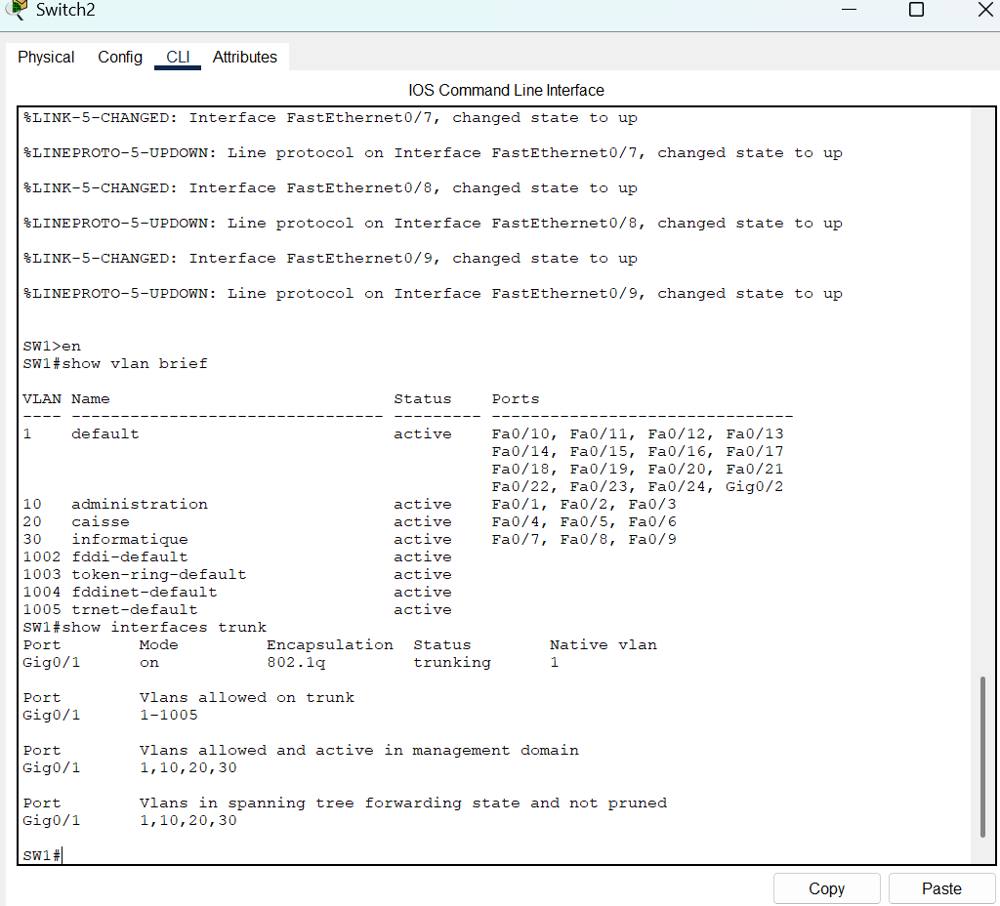
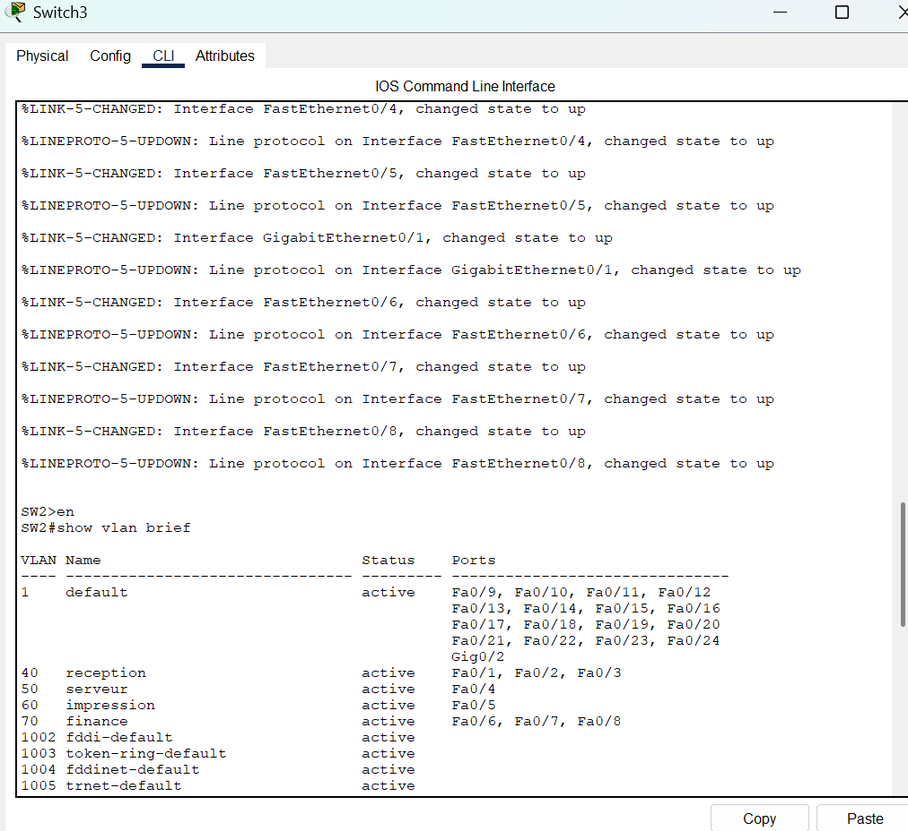

### Liaisons point à point

| Liaison | Réseau | Adresses |
|---|---|---|
| Switch 3650 (SW0) ↔ Routeur | 192.168.100.0/30 | Switch : .1 — Routeur : .2 |
| Routeur (Routeur 1) ↔ « Internet » | 203.0.113.0/30 | Serveur : .1 — Routeur : .2 |

Le bloc 203.0.113.0/24 est réservé à la documentation (TEST-NET-3). L'adresse 203.0.113.2 est une adresse IP simulée et ne représente pas une véritable adresse publique accessible sur Internet.

### Équipements fixes

| Équipement | Adresse | Rôle |
|---|---|---|
| Server0 (VLAN 50) | 192.168.50.5 | serveur DHCP |
| Server1 (« Internet ») | 203.0.113.1 | serveur web + DNS |

## Choix techniques

**Trunks 802.1Q.** Chaque switch d'accès est relié au switch 3650 par un trunk, qui transporte plusieurs VLAN sur un seul câble.

**Routage inter-VLAN avec des SVI.** Le switch 3650 (SW0) a une interface virtuelle (`interface VlanX`) par VLAN. Elle sert de passerelle aux postes du VLAN, et `ip routing` active le routage sur le switch.

**DHCP centralisé.** Un seul serveur DHCP (Server0, dans le VLAN 50) sert tous les VLAN. Les demandes DHCP ne traversent pas les routeurs, donc chaque interface VLAN du switch relaie les demandes avec `ip helper-address 192.168.50.5`. Le serveur a un pool par VLAN, avec la bonne passerelle et le DNS `203.0.113.1`.

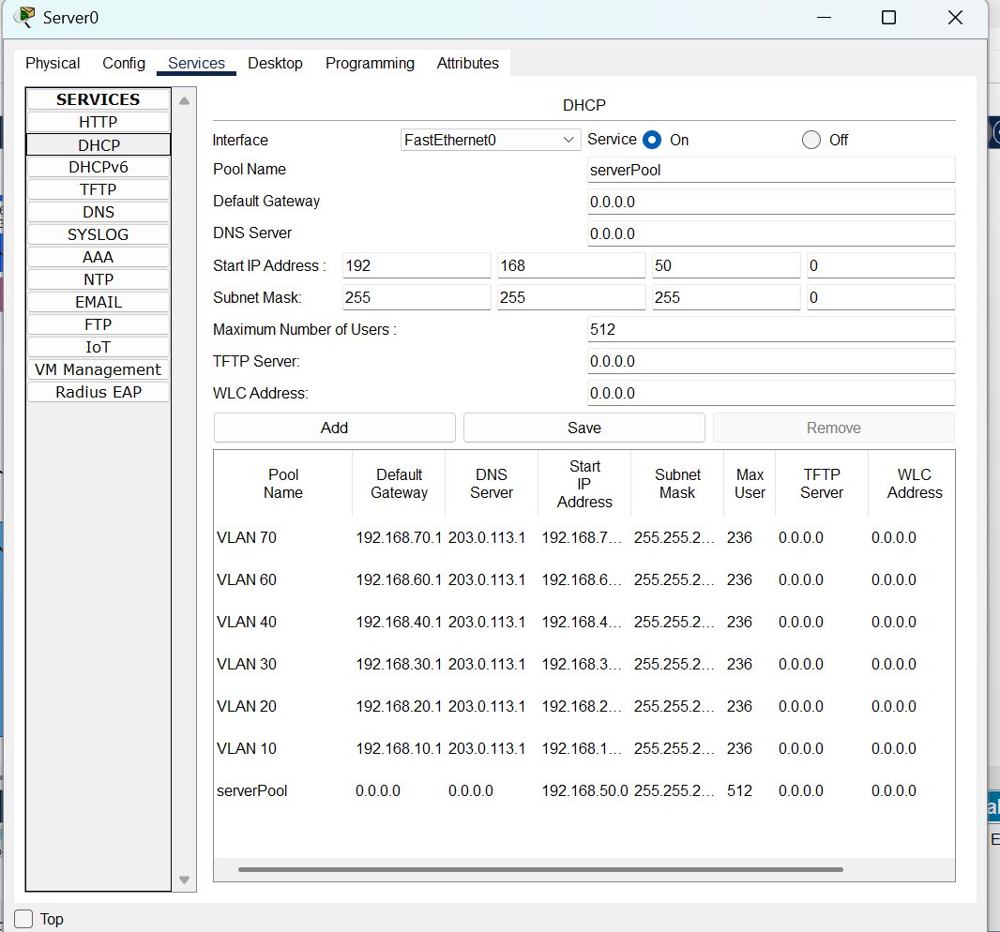

**OSPF (process 7, area 0).** Le SW0 et le routeur 1 échangent leurs routes automatiquement.
- Sur le SW0, `passive-interface default` empêche d'envoyer des annonces OSPF vers les postes ; seule la liaison vers le routeur 1 est active.
- Sur le routeur 1, `default-information originate` annonce une route par défaut aux autres équipements si une route par défaut est présente dans la table de routage du routeur.

**NAT avec surcharge (PAT).** Le routeur traduit toutes les adresses `192.168.0.0/16` vers son adresse publique simulée `203.0.113.2`. Le bloc TEST-NET-3 est réservé à la documentation et n'est pas routé sur l'Internet public.

## Configurations clés

### Switch multicouche (SW0)

```
ip routing

interface GigabitEthernet1/0/1
 switchport mode trunk
interface GigabitEthernet1/0/2
 switchport mode trunk

interface GigabitEthernet1/0/3
 no switchport
 ip address 192.168.100.1 255.255.255.252

interface Vlan10
 ip address 192.168.10.1 255.255.255.0
 ip helper-address 192.168.50.5
! (même principe pour les VLAN 20, 30, 40, 60 et 70)

interface Vlan50
 ip address 192.168.50.1 255.255.255.0

router ospf 7
 router-id 1.1.1.1
 passive-interface default
 no passive-interface GigabitEthernet1/0/3
 network 192.168.10.0 0.0.0.255 area 0
 ! ... idem pour les réseaux 20 à 70
 network 192.168.100.0 0.0.0.3 area 0
```

Le VLAN 50 n'a pas de `ip helper-address` : le serveur DHCP est dans ce VLAN, il reçoit directement les demandes.

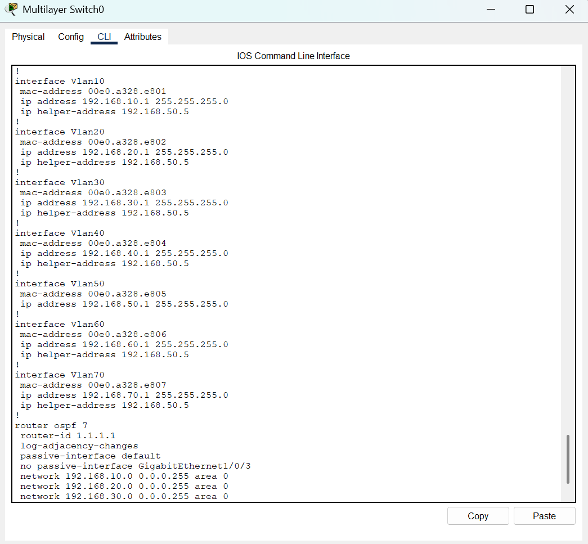

### Routeur (Routeur1)

```
interface GigabitEthernet0/0
 ip address 192.168.100.2 255.255.255.252
 ip nat inside

interface GigabitEthernet0/1
 ip address 203.0.113.2 255.255.255.252
 ip nat outside

router ospf 7
 router-id 2.2.2.2
 network 192.168.100.0 0.0.0.3 area 0
 default-information originate

ip nat inside source list 1 interface GigabitEthernet0/1 overload
ip route 0.0.0.0 0.0.0.0 203.0.113.1
access-list 1 permit 192.168.0.0 0.0.255.255
```

La route par défaut configurée ci-dessus est présente dans la table de routage du routeur et permet à `default-information originate` d'annoncer la route par défaut dans OSPF. L'ACL 1 sélectionne les adresses sources correspondant à cette règle pour la traduction PAT ; elle ne constitue pas une autorisation générale du trafic réseau.

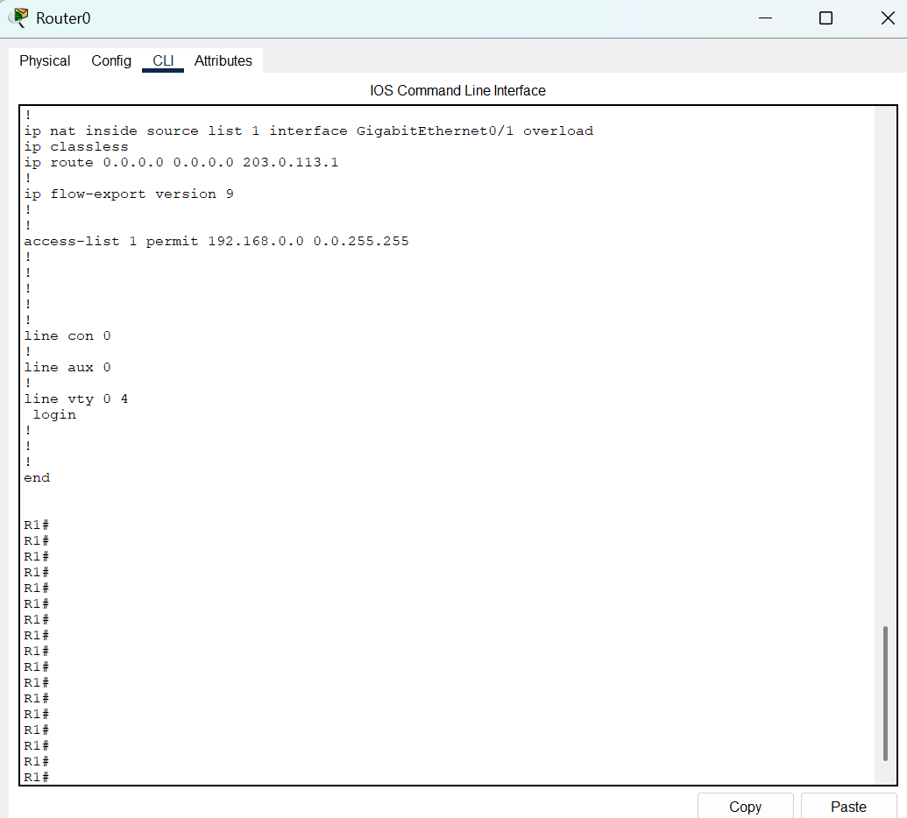

## Tests et validation

| Test | Résultat attendu | Capture |
|---|---|---|
| Route par défaut reçue par le switch | ligne `O*E2 0.0.0.0/0 via 192.168.100.2` | [07](Captures/07-table-routage-switch.png) |
| Traduction NAT sur le routeur | `192.168.40.23` traduit en `203.0.113.2` | [08](Captures/08-nat-translations.png) |
| Ping entre VLAN | réponses reçues | [09](Captures/09-tests-ping.png) |
| Ping vers `203.0.113.1` et `www.internet.com` | réponses reçues, le DNS fonctionne | [10](Captures/10-tests-internet.png) |
| Navigateur web | page « WELCOME TO INTERNET » | [11](Captures/11-test-web.png) |

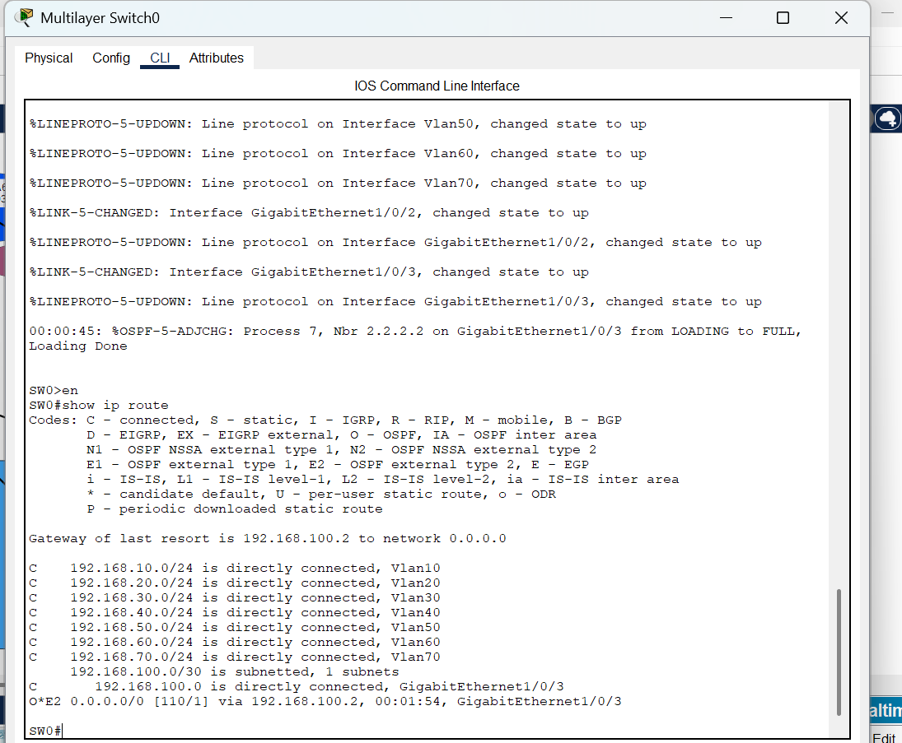
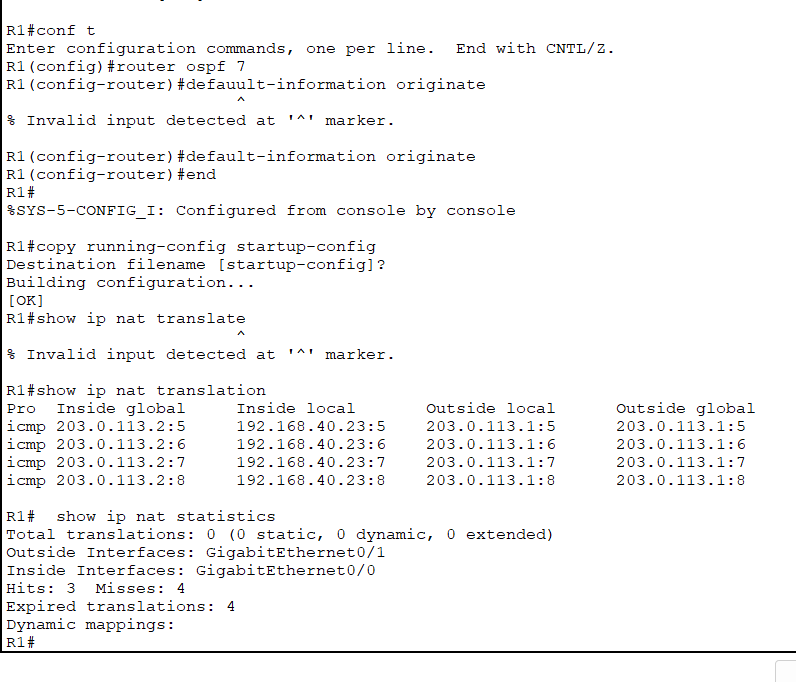
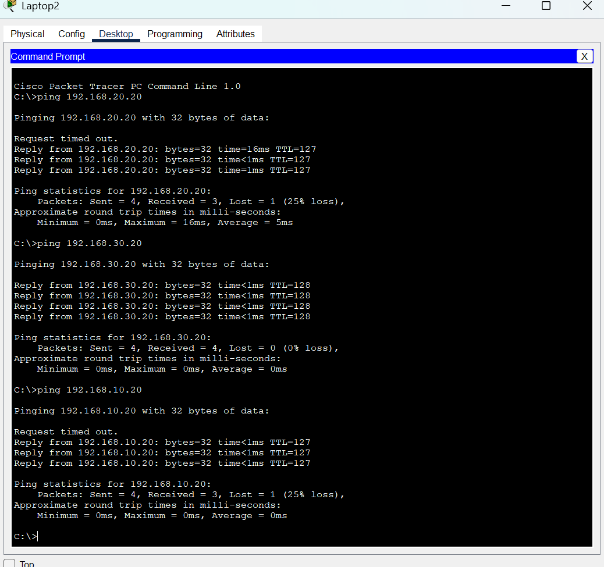
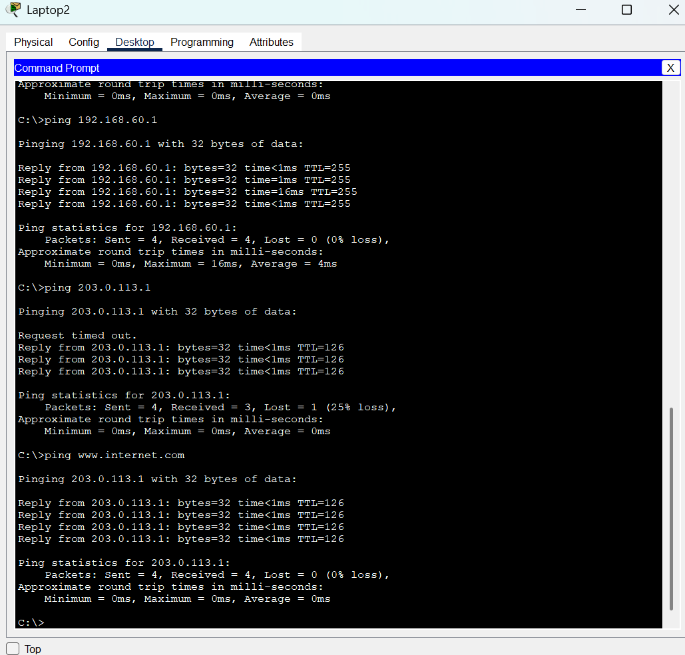
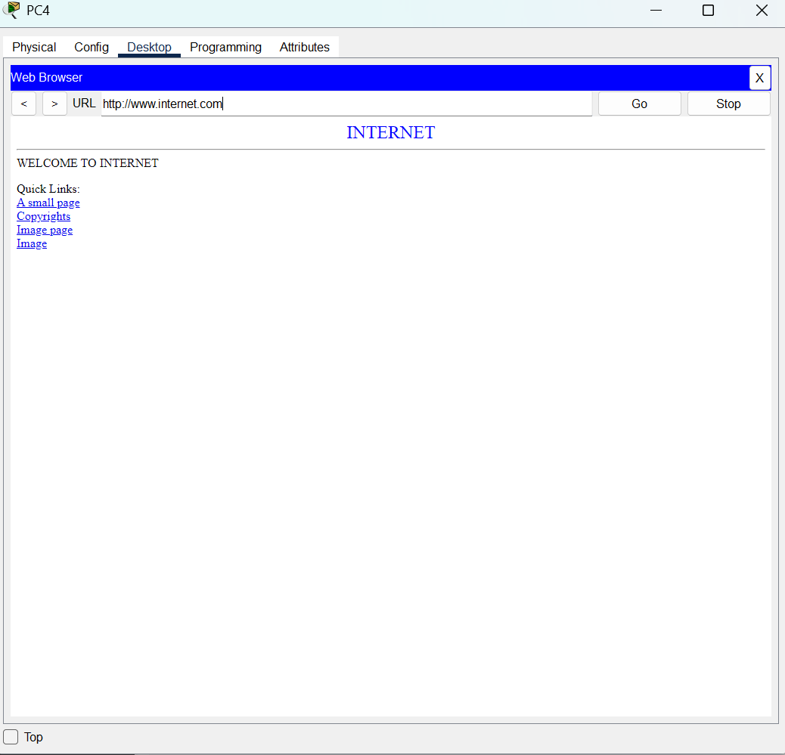

> **Pourquoi le premier ping échoue-t-il ?** Dans les captures, le premier paquet d'un ping est souvent perdu (« Request timed out »). Le premier paquet ICMP peut échouer pendant la résolution ARP. Les équipements doivent d'abord découvrir les adresses MAC nécessaires à la communication.

## Pistes d'amélioration

La configuration actuelle privilégie le fonctionnement du réseau. Pour la rapprocher d'un réseau réel, il faudrait :

- **Sécuriser l'accès aux équipements** : mot de passe `enable secret`, mots de passe sur les lignes `vty`, SSH à la place de telnet, `service password-encryption`.
- **Filtrer le trafic entre VLAN avec des ACL**, par exemple pour limiter l'accès au VLAN finance et au serveur.
- **Protéger les ports d'accès** : `port-security`, DHCP snooping, et arrêt (`shutdown`) des ports inutilisés.
- **Ajouter de la redondance** : un deuxième switch cœur et un deuxième routeur pour éviter un point de défaillance unique.

## Fichiers du dépôt

| Fichier | Description |
|---|---|
| `Réseau PME.pkt` | projet Packet Tracer (à ouvrir avec Cisco Packet Tracer) |
| `Captures/` | captures d'écran utilisées dans ce document |
| `Images/` | ensemble des captures brutes |
